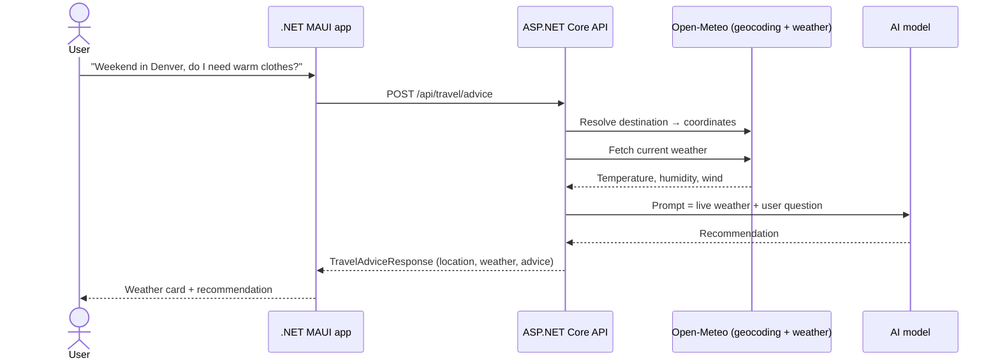

# Travel Organizer: AI + External APIs with .NET MAUI and ASP.NET Core

[](https://github.com/YOUR-USERNAME/TravelOrganizer/actions)

An LLM can't know today's weather in Denver. This project shows how to fix that: a **.NET MAUI** app sends a travel question to an **ASP.NET Core** backend, which fetches live data from an **external API**, hands it to an **AI model** as context, and returns a grounded recommendation.

> Part of my **30-day Generative AI + .NET** series (Day 12: connecting AI with the real world through external APIs).

## Architecture

```
User request → .NET MAUI → ASP.NET Core API → External API → AI Model → Contextual Response → MAUI UI
```



| Layer | Responsibility |
|---|---|
| **.NET MAUI** | UI, MVVM, calls only our backend |
| **ASP.NET Core API** | Validation, orchestration, rate limiting, caching, secrets |
| **External API** | Real-time facts (Open-Meteo, no API key needed for non-commercial use) |
| **AI model** | Interprets the supplied data and writes the recommendation |

Deterministic code fetches and validates the facts. The LLM only interprets them.

## Project structure

```
TravelOrganizer/
├── src/
│   ├── TravelOrganizer.Contracts/   # DTOs shared by API and app
│   ├── TravelOrganizer.Api/         # ASP.NET Core minimal API
│   │   ├── Services/                # Weather, Geocoding, PromptBuilder, AI providers
│   │   └── Options/AiOptions.cs
│   └── TravelOrganizer.Maui/        # MAUI app (Views, ViewModels, Services)
├── tests/TravelOrganizer.Api.Tests/ # xUnit tests
└── .github/workflows/ci.yml         # builds + tests the backend
```

## Getting started

**Prerequisites:** .NET 10 SDK. For the app, also the MAUI workload (`dotnet workload install maui`) and an Android emulator (or Xcode on macOS).

### 1. Run the API

```bash
cd src/TravelOrganizer.Api
dotnet run
```

It listens on `http://localhost:5080`. By default it uses a **mock AI provider**, so the whole flow works without an API key:

```bash
curl -X POST http://localhost:5080/api/travel/advice \
  -H "Content-Type: application/json" \
  -d '{"destination":"Denver","question":"Should I carry warm clothes this weekend?"}'

curl "http://localhost:5080/api/weather?latitude=39.7392&longitude=-104.9903"
```

### 2. Enable a real AI provider (optional)

Keep keys out of source control: use user-secrets locally and environment variables in production.

```bash
cd src/TravelOrganizer.Api
dotnet user-secrets set "Ai:Provider" "Anthropic"
dotnet user-secrets set "Ai:ApiKey"   "<your-key>"
dotnet user-secrets set "Ai:Model"    "claude-sonnet-5-5"
```

| `Ai:Provider` | Notes |
|---|---|
| `Mock` (default) | No key needed; echoes the prompt it would send |
| `Anthropic` | Messages API |
| `OpenAI` | Chat-completions format; works with compatible providers via `Ai:Endpoint` |

Check your provider's docs for current model names and set `Ai:Model` accordingly.

### 3. Run the MAUI app

Start the API first, then:

```bash
dotnet build src/TravelOrganizer.Maui -t:Run -f net10.0-android
```

- The Android emulator reaches your machine via `10.0.2.2` (configured in `Services/ApiConfig.cs`).
- For a physical device, change `ApiConfig.BaseUrl` to your computer's LAN IP or a deployed HTTPS URL.
- Cleartext HTTP is enabled for development only (`AndroidManifest.xml`). Remove it and use HTTPS before shipping.

### 4. Run the tests

```bash
dotnet test tests/TravelOrganizer.Api.Tests
```

## Engineering notes

- **Security:** third-party calls and AI keys live on the backend, never in the app.
- **Resilience:** `AddStandardResilienceHandler` adds timeouts, retries and a circuit breaker. Retries are disabled for the AI POST so a paid call isn't replayed automatically.
- **Rate limiting:** a fixed-window limiter protects the API and the AI provider. For production, partition it per user or IP.
- **Caching:** weather is cached for 10 minutes per rounded coordinate.
- **Validation:** inputs are validated, external responses are mapped into typed records before reaching the model, and the system prompt forbids inventing weather.
- **Culture safety:** URLs and prompts are built with `InvariantCulture`, so decimals never become `39,7392`.

## Roadmap

- [x] Day 12: external API + LLM grounding
- [ ] Streaming responses (SSE / SignalR)
- [ ] Hotels, flights and attractions APIs
- [ ] Observability: latency, failures, token usage
- [ ] Day 13: from chatbot to an **AI agent** that chooses which API to call

## Notes

- Package versions are floating (`10.*`, `8.*`); pin them for reproducible builds.
- The app includes Android and iOS platform folders. Windows and Mac Catalyst can be added by copying their `Platforms/` folders from `dotnet new maui`.
- If the MAUI project doesn't restore with your SDK version, compare `TravelOrganizer.Maui.csproj` with a fresh `dotnet new maui` template.

## License

MIT
